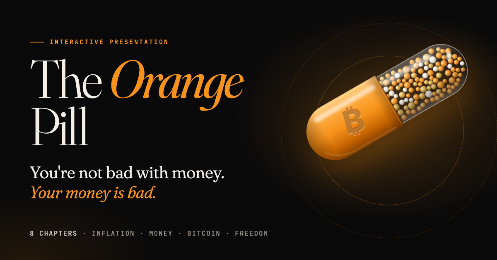

<p align="center">
  <a href="https://orange-pill.github.io/"></a>
</p>

<h1 align="center">The Orange Pill</h1>

<p align="center">
  <strong>A free, interactive presentation on inflation, money and bitcoin.</strong><br>
  Eight chapters · about 20 minutes · 11 languages · no sign-up, no ads, no analytics
</p>

<p align="center">
  <a href="https://orange-pill.github.io/"><strong>▶ Open the presentation</strong></a> &nbsp;·&nbsp; <a href="https://orange-pill.github.io/video/">🎬 Watch the 33-second promo</a>
</p>

---

## What is this?

Most people feel it: you work harder, earn more on paper, and still fall behind. Saving feels pointless, and buying a home feels out of reach. **The Orange Pill** explains why, starting from how money itself works. It then shows why bitcoin, a leaderless, open-source invention from 2009, is a tool that gives that power back to ordinary people.

It's built to be shared with the friend, parent or colleague who has heard of bitcoin but never had it explained calmly, with sources, and without hype. Send them the link, or present it yourself on a big screen.

## What's inside

| | Chapter | What it covers |
|---|---|---|
| I | **The Great Leak** | Why your money buys less every year: the ice-cube analogy, the 97% fall of the 1913 dollar, money printing, the Cantillon effect, 1971, and why everyone was pushed into speculating |
| II | **What Money Really Is** | Money as stored time, what makes money good, the glass-bead tragedy, and why gold won and then lost |
| III | **Enter Bitcoin** | The genesis block, the 21 million cap, why demand can't create more supply, and how it works without the jargon |
| IV | **True Ownership** | Self-custody, "not your keys, not your coins", security, "don't trust, verify", and freedom money |
| V | **How It Compares** | An honest scorecard of cash, gold, real estate, stocks and bitcoin |
| VI | **The Sovereign Mindset** | Time preference, the deflation myth, and moving from customer to owner |
| VII | **Honest Questions** | Straight answers on volatility, crime, energy, bans, copycats, "too late", Ponzi claims, lost keys and quantum computers |
| VIII | **Your First Steps** | A simple, safe path to start, plus a library of the best books, films and podcasts |

### Interactive pieces

- **Inflation calculator:** watch your savings melt over 1 to 50 years at different inflation rates.
- **Live charts:** the dollar's purchasing power since 1913, US money supply since 1960, and bitcoin's supply curve.
- **Mine a block:** your browser does real SHA-256 proof-of-work, then you tamper with the data and watch the proof break.
- **Live supply counter:** how much of the 21 million has been mined, read from the current block height.
- **Comparison matrix:** cash, gold, real estate, stocks and bitcoin side by side: scarcity, portability, verifiability, seizure resistance, cost to hold and more.

## Languages

[English](https://orange-pill.github.io/) ·
[Español](https://orange-pill.github.io/es/) ·
[Português](https://orange-pill.github.io/pt/) ·
[Français](https://orange-pill.github.io/fr/) ·
[Deutsch](https://orange-pill.github.io/de/) ·
[Polski](https://orange-pill.github.io/pl/) ·
[Русский](https://orange-pill.github.io/ru/) ·
[Türkçe](https://orange-pill.github.io/tr/) ·
[中文](https://orange-pill.github.io/zh/) ·
[日本語](https://orange-pill.github.io/ja/) ·
[हिन्दी](https://orange-pill.github.io/hi/)

The translations were made with AI assistance. If you're a native speaker and spot something awkward, corrections are very welcome (see [Contributing](#contributing)).

## Presenting it

Works on phones, laptops and projectors.

| Key | Action |
|---|---|
| `↓` `↑` `Space` `PageDown` | Next / previous slide |
| `Home` / `End` | First / last slide |
| `M` | Contents menu |
| `F` | Fullscreen |

Every slide has its own link (for example [`#icecube`](https://orange-pill.github.io/#icecube) or [`#supply`](https://orange-pill.github.io/#supply)), so you can send someone straight to the part they need. Switching language keeps you on the same slide.

## Sources

Every number on the slides is cited where it appears. The main datasets:

- Purchasing power: US Bureau of Labor Statistics, CPI-U annual averages (1913–2024)
- Money supply: Federal Reserve M2 (FRED `M2SL`), January values, approximate
- Productivity vs pay: Economic Policy Institute (1979–2020)
- Home price vs income: US Census Bureau median new-home price and median household income
- Bitcoin supply: the protocol schedule, with the live counter based on the current block height from [mempool.space](https://mempool.space)
- Energy: Cornell University (Lal, Zhu & You, 2023) and the Cambridge Digital Mining Industry Report (2025)
- Also cited: World Bank Global Findex, Chainalysis, Human Rights Foundation

## Run it yourself

It's plain HTML, CSS and JavaScript, with no framework and no build step to view it. Clone the repo and serve the folder:

```bash
git clone https://github.com/orange-pill/orange-pill.github.io.git
cd orange-pill.github.io
python3 -m http.server 4173
```

Then open http://localhost:4173. Everything it needs is in this repo, except the live block height, which comes from mempool.space.

```
index.html        English source: all slide content
es/ pt/ fr/ …     generated language pages (don't edit by hand)
i18n/             translations: en.json (extracted) + one <lang>.json per language
tools/i18n.mjs    builds the language pages from index.html + i18n/*.json
css/style.css     design, transitions, layout
js/main.js        navigation, charts, calculator, mining demo, live supply, background
assets/           icons, social preview image and music
video/            the promo video page and its MP4s
```

## Contributing

Corrections and improvements are welcome, especially:

- **Translation fixes** from native speakers
- **Factual corrections**, with a source
- **New languages**

To edit text, change the English in `index.html` (or a `t('…')` string in `js/main.js`), then update the translations:

```bash
cd tools && npm install && cd ..   # first time only
node tools/i18n.mjs extract        # refresh i18n/en.json
node tools/i18n.mjs status         # see what each language is missing
# translate the new keys in i18n/<lang>.json (same key → translated text; keep any <strong>/<em>/<span> markup)
node tools/i18n.mjs build          # regenerate the language pages, sitemap.xml and robots.txt
```

Missing translations fall back to English, so nothing breaks while a language catches up. To add a new language, add it to `LANGS` in `tools/i18n.mjs` and to the language menu in `index.html`, create `i18n/<code>.json`, and run the build.

Each slide is a `<section class="slide">` in `index.html`. Chart data sits at the top of each chart function in `js/main.js`.

## Privacy

No analytics, cookies, trackers, ads or third-party scripts. Fonts and images are served from this site, and every page sets a strict Content Security Policy and `no-referrer`. The only outside request is to [mempool.space](https://mempool.space) for the current block height; if it doesn't answer, the page estimates the height from the clock. The only thing stored in your browser is your language choice.

## Credits

- Music: [“Algorithm Runner”](https://pixabay.com/music/pulses-algorithm-runner-dark-cyberpunk-cinematic-music-loopable-185038/) by [JoelFazhari](https://pixabay.com/users/joelfazhari-16466931/), used under the [Pixabay Content License](https://pixabay.com/service/license-summary/). It plays only if you switch the music on, and it loops seamlessly through the Web Audio API.
- Fonts: Fraunces, Inter and JetBrains Mono (plus Playfair Display for Russian and Noto Devanagari for Hindi), self-hosted under the [SIL Open Font License](assets/fonts/OFL.txt). Chinese and Japanese use the visitor's built-in fonts.
- Live block height: [mempool.space](https://mempool.space).

## License

[MIT](LICENSE) for the code and text. The music keeps its own license, listed above. Use it, translate it, present it at your meetup, or fork it into your own version. Books, films, podcasts and quotes referenced in the presentation belong to their respective authors.

---

<p align="center"><em>This presentation is education, not financial advice. Do your own research.</em><br>
<strong>Stay humble. Stack sats. Hold your keys.</strong></p>
